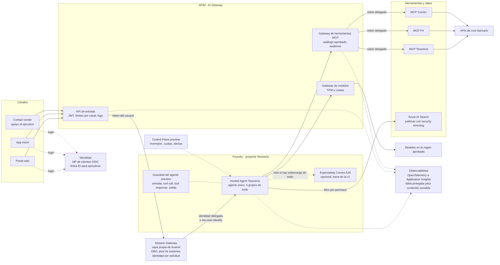

# Arquitectura objetivo del ejemplo resuelto · Austral Bank (Asistente de Tesorería)

> **Ejemplo, no prescriptivo.** Sirve para que los trainers calibren el ejercicio. Cada decisión depende de los supuestos del caso; otro grupo puede llegar a una arquitectura distinta y igual de válida si explica criterio y supuesto. Las cifras son hipótesis.

## Diagrama (flujo de una consulta)

## Cómo se lee

| Capa | Qué decide el ejemplo | Decisión del canvas |
|---|---|---|
| Canales | Web y app comparten API; contact center usa la misma API con la identidad del ejecutivo y el caso del cliente. Teams queda fuera de la v1. | Canal |
| Identidad | El usuario se autentica con su IdP; el Session Gateway valida el token, hace el intercambio delegado (OBO) y envía al agente la identidad del usuario como contexto validado, nunca desde un encabezado que controle el cliente. El agente usa su propia identidad solo para políticas y precios FX. | Identidad |
| Sesión | Pool de sesiones con mapeo usuario → sesión para web/app; sesión 1:1 por (ejecutivo, caso) en contact center. Cada dato propio del contenedor se particiona por (sesión, usuario). | Sesión |
| Agente y modelo | Un solo Hosted Agent con cuatro grupos de herramientas (saldos, FX, comex, normativa). Un especialista Comex por A2A solo si crece la complejidad o aparece una frontera de seguridad distinta. | Agente / modelo |
| Herramientas y datos | Los 3 MCP se publican detrás de APIM (catálogo aprobado, audience, límites, logs). AI Search recorta resultados por permisos con la identidad del usuario. Sin caché semántico para datos por cliente. | Tools / datos |

## Identidad, guardrails y observabilidad: dónde se aplica cada control

| Aspecto | Control en el ejemplo | Madurez según la documentación |
|---|---|---|
| Identidad del agente | Identidad Entra propia del Hosted Agent y rol de menor privilegio. Permiso de suplantación de usuario (`UserIdentityImpersonation`) solo para el Session Gateway. | Agentes (núcleo): GA según la tabla de disponibilidad |
| Identidad delegada | OBO gestionado por el backend (Foundry no intercambia el token por ti). | Patrón de aplicación |
| Guardrails de contenido | Guardrail explícito del agente en entrada, tool call, tool response y salida; Prompt Shields sobre adjuntos de comex. El guardrail de tool call y tool response aplica solo a las herramientas soportadas; MCP no figura en esa lista, así que se compensa con validación de esquema y políticas en APIM. | Guardrails de agentes: preview. Tool call y tool response: preview |
| Red y salida | Red privada de la landing zone y reglas de salida del Hosted Agent. | Controles de salida de red: preview. Trazas con aislamiento de red (Tracing VNet): preview |
| Gobierno de herramientas | Catálogo MCP aprobado a través de APIM. | Gobierno de herramientas con AI Gateway: preview |
| Límites de modelos | TPM y cuota por proyecto en el gateway; alertas de costo. | Control Plane y AI Gateway: preview |
| Observabilidad | Trazas OpenTelemetry hacia Application Insights; el contenido sensible (prompts, respuestas, argumentos) se envía a una tabla protegida con rol privilegiado de lectura. | Trazas de Hosted Agents: GA; protección de contenido sensible según guía de trazas |
| Calidad continua | Evaluaciones recurrentes sobre tráfico real y escaneos de red teaming programados. | Evaluaciones y red teaming: GA (algunos evaluadores en preview); panel de monitoreo: preview |

## Fuera de la v1

Acciones transaccionales (aprobación humana durable), memoria de largo plazo (preview), A2A entre agentes, y cualquier canal fuera de web, app y contact center.

## Supuestos críticos y su primer experimento

1. **Concurrencia:** ~1.500 usuarios con conversación abierta en 15 min frente al límite por defecto de 1.000 sesiones concurrentes por suscripción y región → test de carga y PoC del Session Gateway.
2. **Identidad delegada:** el IdP de clientes puede emitir token delegado con audience propio → prueba con el IdP (ADR de identidad).
3. **MCP detrás de APIM:** los contratos de los 3 MCP no cambian → catálogo piloto con un MCP.
4. **Modelos detrás de un gateway:** en un Hosted Agent el código del contenedor decide a qué endpoint de modelo llama, pero la integración de AI Gateway documentada hoy aplica a prompt agents → validar en el PoC antes de comprometer el diseño.
